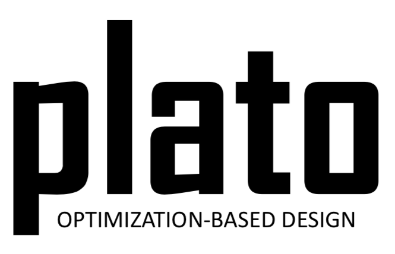

# platoengine

`platoengine` is Sandia National Laboratories’ production software for topology optimization. It serves as the orchestrator for optimization problems by abstracting computational processes into functions, derivatives, and composition rules. These abstractions allow complex optimization workflows to be assembled in a type-safe manner, with composition validity checked at compile time.

`platoengine` supports the definition and optimization of geometries using density-based topology optimization, level-set methods, and shape optimization. These geometry representations define design variables on which gradient-based optimizers operate.

## Overview

`platoengine` provides a modern C++ framework for constructing and solving optimization problems. The software is designed around extensibility, strong compile-time checks, and open-closed design principles.

Core concepts include:

- **Functions and derivatives** as first-class abstractions
- **Compile-time type checking** for valid function composition
- **Gradient-based optimization**
- **Geometry abstractions** for topology, level-set, and shape optimization
- **Plug-in-style extensibility** for objectives, constraints, filters, and geometries
- **Static registration** of components to support modular development
- **CI-gated development** to maintain correctness and stability

## Optimization Capabilities

`platoengine` allows users to define geometries to be optimized and exposes corresponding design variables to an optimizer. Supported geometry and optimization approaches include:

- Density-based topology optimization
- Level-set optimization
- Shape optimization

The optimization algorithms are gradient-based. The default optimizer is **ROL**, the Rapid Optimization Library from Trilinos, which is the primary external dependency of `platoengine`.

## Architecture

The design of `platoengine` emphasizes composability and extensibility.

Objectives, constraints, filters, and geometries are handled as plug-ins and are statically registered. This enables new capabilities to be added without modifying existing core logic, following open-closed software design practices.

Function composition is governed by type compatibility. Functions can only be composed with one another when their types match, and this compatibility is enforced at compile time.

## Dependencies

`platoengine` is written entirely in modern C++.

Major dependencies include:

- [Trilinos](https://trilinos.github.io/), including ROL
- Boost
- Spack-managed third-party libraries

## Build and Installation

`platoengine` uses [Spack](https://spack.io/) to manage build packages and dependencies.

While `platoengine` can be installed directly using Spack, the recommended starting point is the Plato super-project, which provides utilities for setting up the full build environment.

Recommended workflow:

1. Start from the Plato super-project.
2. Use the provided Plato utilities to configure the build environment.
3. Build `platoengine` as part of the Plato software stack.

Direct Spack-based installation is also supported for appropriate developer workflows.

## Branches and Releases

Development is managed through CI-gated branches.

- `develop` contains the most recent features and passes the full test suite.
- Tagged releases follow major, minor, and patch versioning.
- Other branches may represent release, maintenance, or development workflows.

All versions of `platoengine` are gated through CI pipelines.

## Platform Support

`platoengine` is supported on Linux-based systems.

Supported compiler families include:

- GCC
- Clang

Other platforms are not currently supported.

## Contributing

`platoengine` is Sandia production software. External contributions are not accepted.

Development is managed internally, and all changes are subject to project review, testing, and CI requirements.

## Copyright

Sandia National Laboratories is a multimission laboratory managed and operated by National Technology and Engineering Solutions of Sandia, LLC., a wholly owned subsidiary of Honeywell International, Inc., for the U.S. Department of Energy’s National Nuclear Security Administration under contract DE-NA-0003525.

Copyright 2026, National Technology and Engineering Solutions of Sandia, LLC.
